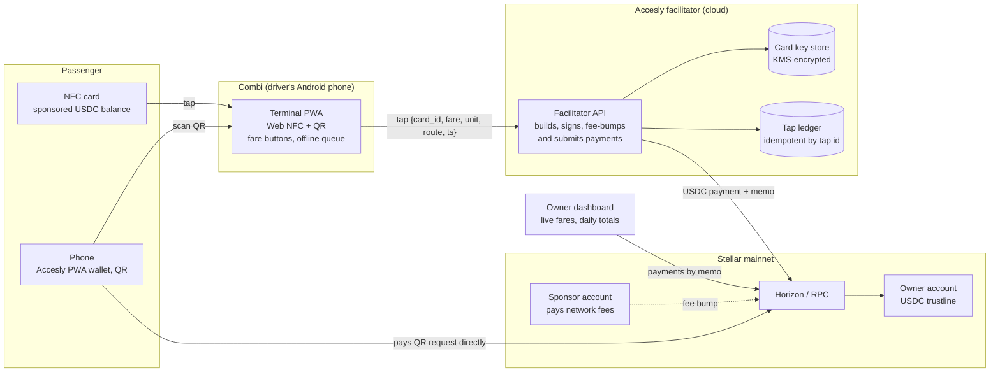
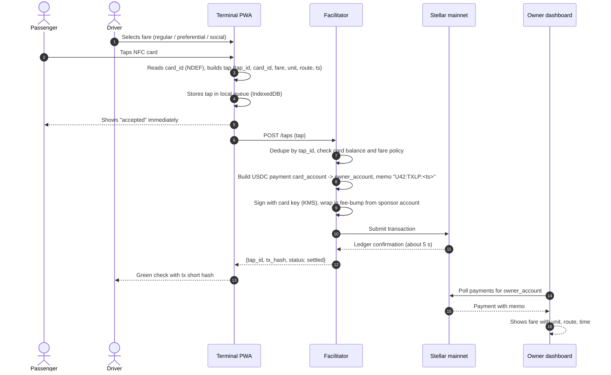
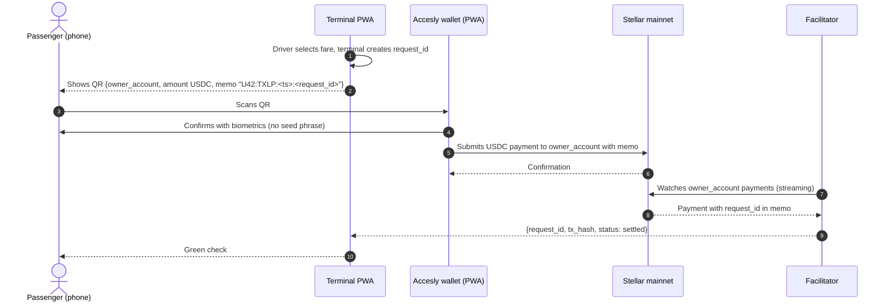
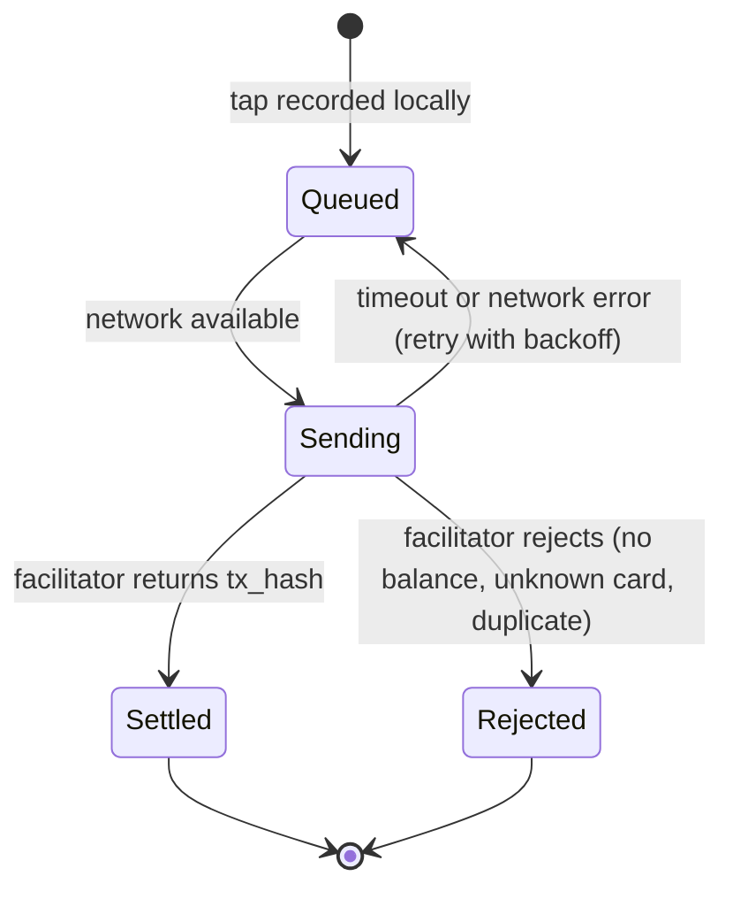
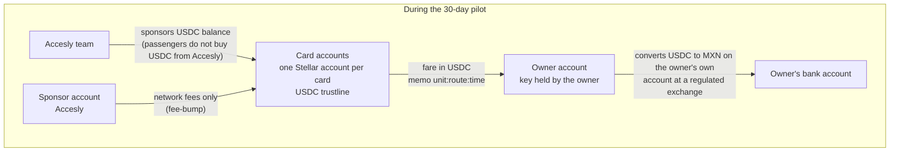

# Accesly NFC fare terminal: architecture

Sprint scope for Instaward #3 (November 2026). One combi on the Texcoco to La Paz route (Estado de México) collects fares with a PWA on the driver's Android phone; every fare settles in USDC on Stellar mainnet directly to the unit owner's account and shows up in the owner's dashboard within seconds.

Design goals, in order:

1. **The owner gets the money, not an intermediary.** Each fare is a USDC payment to an account the owner controls. Nothing is pooled.
2. **The driver needs nothing but an Android phone.** No validator box, no bank terminal, no cash handling.
3. **Sub-dollar fares must be viable.** Stellar fees (about 0.00001 USD) and 5 second finality make a 12 to 15 MXN fare settle for less than the rounding error of a card network.
4. **Works with bad signal.** Taps are queued on the phone and settled when the network is back; the passenger never waits for the chain.

## 1. System overview

**What runs where**

| Component | Runs on | Role | Open source |
|---|---|---|---|
| Terminal PWA | Driver's Android phone, Chrome | Reads NFC card or phone, shows QR fallback, three fare buttons, queues taps offline, confirms in under 5 s | Yes |
| Facilitator | Accesly cloud (Node/TypeScript) | Validates each tap, builds the USDC payment from the card account to the owner account, tags it with unit, route and time, fee-bumps it from the sponsor account, submits, retries | Yes |
| Owner dashboard | Web | Reads the owner account's payments from Horizon, filters by memo, shows live feed and daily totals per unit and driver | Yes |
| Stellar mainnet | Public network | Settlement, audit trail, USDC (Circle issuer) | n/a |

## 2. Fare with an NFC card (main flow)

If the card has no balance or is unknown, the facilitator answers `rejected` and the terminal shows it to the driver, who charges cash as today. Those rejections are logged and count as evidence (the Ruta 9 pilot had 6 of 10).

## 3. Fare with a phone (QR fallback)

For passengers with an iPhone or a phone without NFC, and for any passenger who prefers their own wallet. The terminal shows a payment request as a QR; the passenger's Accesly PWA wallet (the existing non-custodial MPC stack) pays it directly on Stellar. The facilitator only watches for the payment.

## 4. Offline behaviour of the terminal

Combis lose signal constantly. The terminal never blocks the boarding line on the network.

- Every tap carries a client-generated `tap_id` (UUID). The facilitator is idempotent on it, so retries never double charge.
- The terminal shows the driver three counters: settled, pending, rejected. Pending taps older than 10 minutes are flagged.
- The facilitator applies the same rules on retry: a card cannot go below zero even if several taps arrive late in a burst.

## 5. Accounts, keys and money

| Account | Who holds the key | Holds | Notes |
|---|---|---|---|
| Card account (one per card) | Facilitator, in a KMS-encrypted key store, for the pilot only | Sponsored USDC balance | Balances are test money funded by the team. Moving to passenger-held keys (Accesly's passkey smart accounts) is the step after the pilot. |
| Owner account | The unit owner (Accesly never holds this key) | USDC fares | Created with the owner in week 2. The owner converts to pesos on their own exchange account. Accesly is not a ramp. |
| Sponsor account | Accesly | XLM for fees | Pays network fees through fee-bump transactions so cards never need XLM. |
| Passenger phone wallet | The passenger (MPC 2 of 3, no seed phrase) | Their own USDC | Existing Accesly wallet. Used in the QR flow only. |

**Memo format.** Text memo, 28 bytes max: `U42:TXLP:1733036100` = unit 42, route Texcoco to La Paz, Unix time of the tap. The dashboard, the pilot report and anyone with the owner's public address can reconstruct every fare from the public ledger without trusting Accesly.

## 6. Trust and failure model

| Risk | Mitigation in this sprint |
|---|---|
| Driver skips the tap and takes cash | Owner sees settled fares per unit and per shift in minutes; the pilot measures taps against the driver's own count. Not solved by software alone; it is what the field feedback is for. |
| Card cloned or replayed | Card id is only a lookup key; the facilitator holds the key and enforces balance and one fare per card per 60 s per unit. Post-pilot: passenger-held keys. |
| Facilitator down | Terminal keeps queuing; nothing is lost; settlement resumes. Owner sees "pending" honestly instead of a fake total. |
| Lost phone | Terminal has no keys. Facilitator revokes the device token. |
| Regulatory | No fiat touches Accesly: balances are sponsored, the owner off-ramps on their own regulated exchange account. No custody of passenger money during the pilot. |

## 7. Explicitly out of scope

Automated fiat on/off ramps and any KYC-gated ramp; hardware validators; native iOS NFC (QR instead); more than one unit or route; integration with government fare systems or other operators' cards; changes to Accesly's existing smart-account contracts on mainnet.

## 8. Evidence this design builds on

Ruta 9 pilot, vehicle U-42, Temixco (Morelos), 23 to 30 August 2026, closed-loop token MXNT on Stellar mainnet: 10 taps, 4 fares of 13 MXN settled on-chain, 6 rejected.

- https://stellar.expert/explorer/public/tx/c0e47a8ba406f70e34653ab9aaa4e0fdfdd010899ba1077fef855312dd482e39
- https://stellar.expert/explorer/public/tx/e6481b5815be370d62abca4b4cff1a94b8b3668b2a7b57193c27edcb4268919a
- https://stellar.expert/explorer/public/tx/6abfc85f860f4145a479c8561ff950280994508fd79d1c4eac51b95d22e09469
- Token and accounts: https://stellar.expert/explorer/public/asset/MXNT-GAL45E3RPF2PY63JBQPPEFZLUNZY6X7B6CKL5IW7SERYH6YI2J5IZHE6

The research and regulatory analysis behind the closed-loop design (August 2026) is in [`fare-collection-research-morelos.md`](./fare-collection-research-morelos.md). This sprint keeps that account model and replaces the closed-loop token with USDC and the hardware validator with the PWA.
