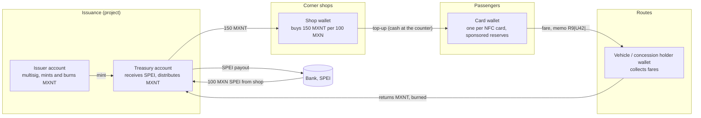
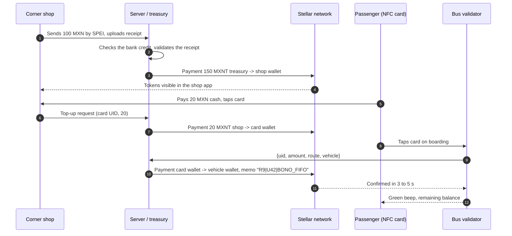
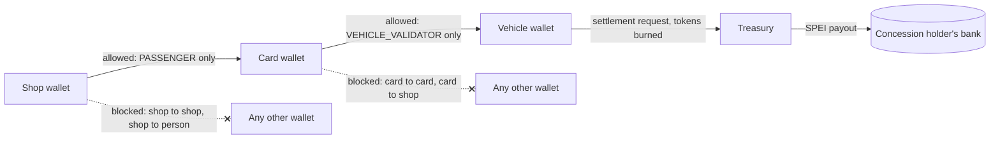

> **Note (November 2026).** This is the research and design work from August 2026 that led to the Ruta 9 pilot (Temixco, Morelos), where the first fares were settled on Stellar mainnet with a closed-loop token (MXNT). The Instaward #3 sprint keeps this account model and changes two things: the validator becomes a PWA on the driver's phone (Web NFC and QR) and settlement is in USDC instead of the closed-loop token. See [`ARCHITECTURE.md`](./ARCHITECTURE.md) for the current design.

# From the bank gateway to the closed-loop wallet

**Research, diagnosis and implementation plan for a digital fare collection system for public transport in Morelos**

Version: August 2026 · Author: project lead · Status: working document

---

## Executive summary

This document reconstructs the research process that led to the final design of the fare collection system for public transport in Morelos. The sequence was:

1. We tried to build our own payment terminal to collect fares. We found that Mexican bank rails are closed by design: anyone who is not an authorised acquirer or aggregator depends on proprietary SDKs, fees they cannot negotiate and limits on customisation.
2. We evaluated blockchain as a way out. We found that blockchain solves the cost of *settlement*, but not the cost of *moving fiat in and out* (on-ramp/off-ramp), which is where the fee and the regulatory friction live.
3. We looked into whether KYC could be removed or made invisible (card data, zero knowledge). It cannot: in Mexico, dealing in virtual assets requires identification from the first peso.
4. We reframed the question: instead of asking how to make fiat-to-crypto conversion cheaper, we asked **how to avoid having to do it at all**.
5. The answer was a **closed-loop wallet**: a transport token that is not convertible in the user's hands, topped up with cash at corner shops, settled to concession holders by SPEI bank transfer, and recorded on Stellar for traceability and multi-party audit.

The central conclusion: **the savings do not come from the technology, they come from the regulatory perimeter.** By keeping the balance inside a closed circuit for a single service, the system stays off the card rails, outside the definition of electronic payment funds, and below every identification threshold in the anti-money-laundering law.

---

## 1. Starting point: why fares cannot be collected cheaply

### 1.1 The aggregator wall

The first attempt was to build a fare collection app. The operational findings were consistent:

- **There is only one door.** Taking card payments means going through a bank gateway or aggregator, and the fees they offer a small merchant are high for the average transport ticket.
- **The SDK is the cage.** To run and customise a terminal you must use the provider's SDK. That means the provider defines the checkout experience, the reconciliation flow and, above all, the fee. There is no technical room to negotiate.
- **Customisation is limited by contract, not by technology.** In several cases, configuring extra behaviour on the terminal (custom flows, fare logic, integration with dispatch) is simply not allowed, even though the hardware supports it.

### 1.2 Becoming your own acquirer

The obvious way out would be to become a gateway and keep the margin. That path exists, but it is institutional, not technical: it means becoming a partner or client of a processor such as Prosa, negotiating directly with the card networks, and meeting a list of certification, capital, security and compliance requirements. It is not a problem solved by writing code; it is solved with years and a balance sheet.

### 1.3 The important finding: the problem is the micropayment, not the percentage

This is the point that reordered the whole analysis. The public debate about fees focuses on the percentage, but in transport the percentage is not what breaks the model: **it is the fixed component**.

In Mexico, the interchange fee, what the issuing bank charges the acquirer, can reach 1.15% of the amount on debit cards, capped at 13.50 pesos per transaction, and up to 1.91% on credit cards. On top of that fee, the acquirer adds its discount rate and its margin.

On a 10 peso fare, even an aggressive 2% discount rate leaves 0.20 pesos of ad valorem fee. The problem is that no card transaction costs 0.20 pesos to run: there is online authorisation, routing, clearing, settlement, fraud prevention, chargeback handling and reconciliation. The real per-transaction cost of the card rail has a fixed floor which, on a 10 peso ticket, is an unacceptable share of revenue.

**Corollary:** any architecture that collects fares transaction by transaction over the card rail is doomed by arithmetic, not by bank greed. The solution is not to negotiate a better fee. It is to **take the micropayment off the rail** and aggregate it: the expensive operation (money coming in) should happen once per many trips, not once per trip.

This idea, aggregating micropayments outside the expensive rail, is exactly what transport systems around the world do with prepaid cards, and it is what ended up steering the final design.

---

## 2. The blockchain hypothesis and where it breaks

### 2.1 The cost moved, it did not disappear

The second hypothesis was to use blockchain: if settlement costs fractions of a cent, the fare can be collected without a meaningful fee. That is true, and it is why Stellar remains in the final design, but it is incomplete.

People's money is born in fiat. For an on-chain balance to exist, someone had to convert pesos into tokens (*on-ramp*) and, at the end of the chain, convert tokens back into pesos (*off-ramp*). That is where everything we wanted to avoid reappears:

- On-ramps and off-ramps charge fees, and with several providers that fee is **higher** than on conventional rails.
- Both require KYC, and in some cases KYB, which makes mass passenger onboarding unworkable.
- Most providers are built for dollars, not for the local stablecoins of specific countries. Converting MXN → USDC → MXN adds an FX hop and a spread.
- In the Stellar ecosystem in particular, the supply of ramps for the Mexican peso is thin, which blocks real adoption.

**Interim conclusion:** the friction is not on the chain. It is at the doors.

### 2.2 "Crypto cards" do not bypass the rail: they use it

An assumption worth breaking: the crypto debit cards that exist today (from exchanges and from card-as-a-service providers) **are not an alternative rail**. They are ordinary Visa or Mastercard cards with an automatic off-ramp behind them. The merchant pays exactly the same discount rate and the same interchange fee as with any other card.

In other words: there is no "fiat-to-crypto tap to pay" today that makes collection cheaper. What exists is a conventional tap to pay with crypto settlement behind it. The perceived savings in those products usually come from subsidy or from yield on reserves, not from rail efficiency.

### 2.3 Peso stablecoins: they exist, but they solve a different problem

The Mexican peso stablecoin market is no longer theoretical. MXNB is a stablecoin backed 1:1 by the peso, issued by Juno, a Bitso company, minted by depositing MXN via SPEI and redeemed back to pesos into Mexican bank accounts. There are also MMXN, backed by Monetary Digital, and MXNe, launched by the US issuer Brale on Solana and Stellar, the latter especially relevant given the project's choice of network.

But it is worth reading precisely what they are for. MXNB is designed as a settlement primitive: held for minutes or hours between receiving dollars and pushing pesos out via SPEI, not as a balance to hold. It is **B2B cross-border treasury** infrastructure, not **retail collection of 10 peso fares**. Adopting it for fares would have meant inheriting the whole per-user on-ramp/off-ramp problem.

---

## 3. Regulatory research: what Mexican law actually says

This was the section that defined the design. Three research questions were posed at the start, and all three have answers.

### 3.1 When does KYC apply in the fiat ↔ crypto process?

**Answer: always, and the framework was recently tightened.**

Exchanging virtual assets is a vulnerable activity under article 17 of the Federal Law for the Prevention and Identification of Operations with Illicit Funds (LFPIORPI). Unlike other categories, identification here is required from the first peso, with no minimum threshold.

In addition, the LFPIORPI reform published on 16 July 2025 lowered the reporting threshold to the SAT (tax authority) for virtual assets from 645 UMA to 210 UMA, a 67% cut, equivalent to 24,635.10 pesos. The same reform extended record retention from 5 to 10 years, shortened the reporting window for unusual operations to 24 hours and introduced an obligation to implement automated detection mechanisms.

This closes the door on the original idea of "doing KYC with the user's card data". Card data is not identification under the LFPIORPI: the law requires verifying identity against officially recognised identity documents and keeping a copy. There is no path where the user does not register.

### 3.2 ZK-KYC: why it does not solve the problem at hand

The intuition about zero knowledge read the problem correctly but pointed at the wrong variable.

Zero-knowledge proofs let you **minimise disclosure**, proving "this user was verified and is not on any list" without revealing who they are, and they are excellent for privacy and credential portability. What they do not do is **remove the issuance of the credential**: someone, at some point, had to check official documents against a real person. Onboarding still exists; only who sees it afterwards changes.

And for the transport use case, onboarding *is* the problem. A passenger boarding a bus in Temixco is not going to complete an identity onboarding to pay 10 pesos, with or without elegant cryptography behind it. The friction that kills adoption is in the first minute, not in the file.

### 3.3 Fintech Law: why you cannot be "a wallet" without being one

The relevant framework is the Law to Regulate Financial Technology Institutions (Fintech Law, 2018). Three pieces matter:

**a) The activity is reserved.** Article 22 establishes that services offered to the public on a habitual and professional basis consisting of the issuance, administration, redemption and transfer of electronic payment funds, through applications, interfaces or websites, may only be provided by Electronic Payment Fund Institutions (IFPE). Operating without authorisation is not a grey area: it is a reserved activity.

**b) Authorisation is slow and expensive.** IFPE authorisation times reported by the market are measured in years, not months. For a state transport pilot, that path is incompatible with any reasonable calendar.

**c) Banxico closed the crypto door to the end customer.** Circular 4/2019 is explicit: institutions may only carry out virtual asset operations that correspond to internal operations, with prior authorisation from Banxico, and operations through which they intend to directly provide their clients with exchange, transfer or custody services for virtual assets are not eligible for authorisation.

Translated: in Mexico, not even an authorised IFPE can offer crypto to its user. Crypto can live **behind** the operation, not **in front of** the customer. This finding is decisive for the design: it forces the user never to see, hold or manage a virtual asset.

### 3.4 The gap that does exist: article 24 and the prepaid thresholds

Here is the legal way out of the problem, and it is not in crypto: it is in the nature of the instrument.

**Exclusion from the Fintech Law.** Article 24 establishes that rights derived from loyalty or reward programmes offered by legal entities to their customers, which can only be accepted by those entities or by companies affiliated to such programmes in exchange for goods, services or benefits, are not considered electronic payment funds, provided they cannot be converted into currency. This is why meal vouchers and loyalty programmes fall outside the Fintech Law regime.

**Anti-money-laundering thresholds.** The instrument does fall under section II of article 17 of the LFPIORPI, which covers the habitual or professional issuance or sale of cards not originating from financial institutions, including prepaid cards and any instrument that stores monetary value. But the thresholds are generous for this use case: for prepaid cards and for wallets, vouchers or certificates, both the identification threshold and the reporting threshold are 645 UMA, equivalent to 75,664.95 pesos in 2026.

**Why this changes everything:**

| Path | User identification | Report to SAT |
| --- | --- | --- |
| Virtual asset exchange | From the first peso | From 210 UMA (~24,635 pesos) |
| Prepaid card / closed-loop wallet | From 645 UMA (~75,665 pesos) | From 645 UMA (~75,665 pesos) |

A transport card with balances of 20 to 150 pesos and 50 peso top-ups never comes close to 75,665 pesos in one operation. **The passenger does not need KYC.** Not because regulation is evaded, but because the legislator already decided that a low-value, closed-loop, non-convertible instrument does not pose a money-laundering risk.

The obligation to register as a vulnerable activity, keep a guidelines file, retain records for ten years and train staff **does apply to the issuer**. That is a manageable administrative load, not a barrier to entry.

---

## 4. The underlying question: is money a closed circuit?

After exhausting the technical paths, a more uncomfortable question appeared: if there is no way to collect without a fee, not even in a closed loop, is money a deliberately closed system, where regulation and bank concentration prevent new economic models from emerging?

The honest answer is nuanced, and it is worth writing precisely because how the project is presented to government and investors depends on it.

**What is true:** access to the payment rail is reserved, the reservation is expensive, and the cost of entry structurally favours incumbents. A developer with a good idea cannot simply "connect to payments" the way they connect to an API. That is a real barrier with real effects on innovation.

**What is not true:** that the barrier exists *only* to protect rents. A good part of the rail's cost is the cost of guaranteeing settlement, absorbing fraud, resolving chargebacks and sustaining anti-money-laundering traceability. A payment system without those guarantees is not a cheaper system; it is one that shifts the risk to the user. The fee pays for something.

**What follows for the project:** the winning strategy is not to fight the rail or try to replicate it. It is **not to need it**. A low-value closed loop, with a single category of consumable good (the fare), needs no interbank settlement guarantee, generates no chargebacks and moves no risky amounts. That is why it can be cheap: because it does less, not because it is smarter.

---

## 5. The turn: cash → digital value, without going through the user's bank

The question that unlocked the design was: **how does someone obtain digital value without going through the banking system, if they were born inside a fiat system?**

The answer is cash. In Morelos, fares are paid in cash, most passengers neither have nor want a banking app, and corner shops are already the de facto financial touchpoint of the neighbourhood.

The original version of this idea was a cash-to-crypto business charging 1% on receiving the cash. That version does not survive the regulatory analysis of section 3: receiving cash and delivering a virtual asset is a virtual asset exchange, with identification from the first peso, reporting from 210 UMA and the whole apparatus of the 2025 reform. Besides, the benefit to the user would be diffuse: most people do not want crypto, they want the bus to work.

But the **structure** of the idea does survive, with a one-word change: instead of converting cash into a **virtual asset**, cash is converted into a **right to transport**.

- Cash comes in through the corner shop, which is the natural touchpoint.
- What the passenger receives is neither money nor a virtual asset: it is a balance that can be consumed in a single service.
- Real money never leaves the formal banking system: the shop pays by SPEI, the concession holder gets paid by SPEI. Only the *right of use* circulates digitally.
- The benefit to the user is not ideological, it is concrete: no queue, no change, a balance you can top up on the corner, and bonus trips.

This is the moment the project stops being "a crypto product for transport" and becomes "a transport system that uses a chain to audit itself".

---

## 6. Why the closed-loop wallet is the right answer

Recapping the full decision tree:

| Alternative | Why it was discarded |
| --- | --- |
| Terminal through an aggregator (Clip, Mercado Pago, etc.) | Fee incompatible with a 10 peso ticket; closed SDK; no control of the product |
| Becoming an acquirer / own gateway | Institutional barrier (Prosa, certifications, capital), not technical |
| Crypto wallet per passenger with on-ramp/off-ramp | Mandatory KYC from the first peso; ramp fees higher than conventional rails; Circular 4/2019 forbids offering crypto to the customer |
| Crypto debit card | Runs on the same Visa/Mastercard rail; same cost |
| Peso stablecoin as the user's balance | Good for B2B treasury, not for retail collection; inherits the ramp problem |
| **Closed-loop wallet recorded on Stellar** | **Adopted** |

### What Stellar adds if the system is closed

The first serious evaluator will ask this, so the answer should be written down: if the loop is closed, why not a database?

Stellar provides three things a database does not give for free:

1. **Multi-party audit.** The Ruta 9 concession holders do not need to trust the system operator or each other: every fare is independently verifiable against the ledger. In an association where the historical conflict is about who collected what, this is not a technical detail, it is the political condition for adoption.
2. **Instant settlement between accounts** at negligible per-operation cost, which is exactly the micropayment requirement identified in section 1.3.
3. **Subsidy traceability.** The `Memo` field lets you follow a batch of bonus tokens from the shop that sold them to the vehicle where they were redeemed. That data is the argument before the Ministry of Mobility and before any funding source: subsidy with proof of destination.

What Stellar does **not** provide here is a way around regulatory costs. The savings come from the legal perimeter, not from the chain. It is worth saying it that way in presentations, because a financial evaluator will spot it immediately if it is presented the other way round.

---

## 7. Open risks in the final design

These points do not invalidate the plan, but they must be resolved before scaling beyond the pilot. Listed in order of severity.

**7.1 The article 24 exclusion requires non-convertibility.** The exclusion applies to instruments that **cannot be converted into currency**. In the design, the concession holder returns tokens to the treasury and receives a SPEI transfer. That is a redemption in money. The defensible argument is that non-convertibility applies to the **consumer holder** (the passenger, who can only spend on fares) and that settlement to the concession holder is payment for a service rendered, not a redemption of balance. That argument must be backed by a written legal opinion before operating beyond the pilot. **Action: formal legal opinion on the classification of the instrument.**

**7.2 The token is not backed 1:1.** 150 MXNT are issued against 100 MXN received. If every token is redeemed at par, the treasury has a structural deficit of 50 pesos for every 100 received. That differential is the customer acquisition cost agreed with the transport association, which is legitimate, but **it must be provisioned and booked as a liability from day one**, not discovered at the end of the month. **Action: treasury model with issued liability vs. cash received, and an explicit source for the subsidy.**

**7.3 Manual reconciliation does not scale.** Checking SPEI receipts by hand is right for the pilot and is the proper defence against duplicated receipts, but it breaks at 50 shops. **Action: move to a unique reference CLABE per shop, with automatic credit reconciled by identifier, keeping manual approval only for exceptions.**

**7.4 Key custody.** The server holds the private keys of every card and of the treasury. The system is as secure as that store. **Action: HSM or a real encrypted vault from the pilot onward, multisig on the issuing account, and strict separation between the issuing key and the relayer key.**

**7.5 Privacy and the public ledger.** The passenger's UID and their full travel pattern end up on a public, immutable record. Even if the UID is pseudonymous, a daily travel pattern is re-identifiable. This interacts with the LFPDPPP (data protection law). **Action: privacy notice, identifier rotation and metadata minimisation in the `Memo` field.**

**7.6 No offline queue.** It was decided that without internet there is no charge. That is the right decision against double spending, but it means uncollected fares in areas without coverage. **Action: measure in the pilot the share of attempts that fail on connectivity before deciding whether a deferred-signature scheme with a risk limit is worth it.**

**7.7 Reclassification risk.** If the token were to circulate outside the loop, accepted by a third party or exchanged between people, it could be classified as a virtual asset under the Fintech Law, with the whole regime on top. The wallet control rules in section 5 of the plan **are not a technical optimisation: they are the core of the legal argument.** They must be treated as a critical requirement, not as configuration.

---

## 8. Pending research agenda

1. Written legal opinion on the classification of the instrument (Fintech Law art. 24 vs. LFPIORPI art. 17 section II).
2. Registration in the SAT's Register of Vulnerable Activities and an identification guidelines document within 90 days of starting operations.
3. Tax treatment of discounted issuance: is it a trade discount, a promotional expense or deferred revenue? Validate with the transport association's chief accountant.
4. Applicable regime if the system is later extended to more than one service or to merchants (that is where it leaves the closed loop).
5. Formal per-transaction cost comparison against aggregator fees, with pilot data, for the tender file.
6. Precedents: how the transport card systems already operating in Mexico classified their instrument, and which legal figure each uses.

---

# 9. Final plan

> This section is kept unchanged from the original document.

# Technical infrastructure for Morelos transport, final

# Closed-loop fare collection system for public transport in Morelos

This document brings together the technical, operational and financial architecture for implementing a digital fare collection system for the transport network (e.g. Ruta 9 and local concession holders) in the State of Morelos, using the **Stellar Network**.

## 1. Project overview

The goal is to modernise fare payment through **physical NFC cards** without requiring the end user to download apps, set up wallets or handle seed phrases.

To speed up adoption across the route network (Cuernavaca, Temixco, etc.), a commercial incentive model is implemented with local grocery shops:

- **Network mapping:** strategic corner shops are selected along the route circuit.
- **Incentive model:** for every 100 MXN in real money the shop transfers by **SPEI**, it is credited **150 Transport Tokens (MXNT)**.
- **Shop margin:** the shop sells those 150 tokens to passengers for cash (1 MXNT = 1 MXN). On selling all the tokens, the shop recovers its 100 MXN investment and earns **50 MXN**.
- **Operational impact:** those extra 50 MXN are commercially equivalent to subsidising about 3 to 5 fares per top-up as the customer acquisition cost (CAC) agreed by the transport association.

## 2. Architecture on the Stellar Network

Stellar is selected for its confirmation times (3 to 5 seconds), its negligible fees (0.00001 USD) and native support for digitised assets.

### Account structure and control

- **Issuer account:** multisig vault managed by the project lead. It is the only account allowed to create (*mint*) or destroy (*burn*) the **`MXNT`** token.
- **Treasury account (distributor):** intermediate account that receives the bank transfers and distributes the authorised tokens.
- **Custodial wallets for NFC cards:** accounts created automatically on the server for each physical card in circulation. Through Stellar's **account sponsorship** mechanism, the platform absorbs the minimum XLM reserves so the user operates only with the `MXNT` token.
- **Vehicle / concession holder wallets:** accounts assigned to each vehicle or concession holder where fare payments land.



## 3. End-to-end system flow



```txt
 [ CORNER SHOP ]            [ SERVER / TREASURY ]                  [ STELLAR NETWORK ]                [ BUS VALIDATOR ]
      │                               │                                     │                                  │
  1.  ├─ Sends 100 MXN by SPEI ──────►│                                     │                                  │
      ├─ Uploads receipt / ticket     │                                     │                                  │
      │                               │                                     │                                  │
  2.  │                               ├─ Checks payment at the bank         │                                  │
      │                               ├─ Validates receipt legibility       │                                  │
      │                               │                                     │                                  │
  3.  │                               ├─ Signs and executes Payment ───────►│                                  │
      │                               │  (150 MXNT)                         ├─ Mint/Transfer 150 MXNT ────────►│ (Shown in the
      │                               │                                     │  to the shop's wallet            │  shop's app)
      │                               │                                     │                                  │
  4.  ├─ Receives 20 MXN in cash      │                                     │                                  │
      ├─ Scans passenger's NFC card   │                                     │                                  │
      │                               │                                     │                                  │
  5.  │                               ├─ Relayer server executes:           │                                  │
      │                               │  Payment: shop -> NFC wallet ──────►│                                  │
      │                               │                                     ├─ Transfers 20 MXNT to NFC wallet │
      │                               │                                     │                                  │
  6.  │                               │                                     │                                  ├─ Passenger taps the
      │                               │                                     │                                  │  NFC card on the reader
  7.  │                               │◄─ Sends UID + vehicle ID ────────────────────────────────────────────┤
      │                               │                                     │                                  │
  8.  │                               ├─ Relayer executes Payment with Memo:│                                  │
      │                               │  • From: NFC wallet (UID)           │                                  │
      │                               │  • To: concession holder's wallet   │                                  │
      │                               │  • Memo: "R9|U42|BONO_FIFO" ───────►│                                  │
      │                               │                                     ├─ Confirms tx (3-5 s) ───────────►│ Green beep and shows
      │                               │                                     │                                  │ remaining balance
```

## 4. Technical detail of the processes

### Phase A: manual validation and regulated issuance of balance (minting)

To prevent duplicated-receipt attacks, balance issuance is not automatic via bank webhook; it includes verification:

1. **Deposit and request:** the shopkeeper transfers 100 MXN by SPEI to the project's concentrator account and attaches the receipt/photo in their POS app.
2. **Reconciliation:** an administrator checks that the payment is actually credited in the bank portal and approves the order in the dashboard.
3. **Execution on the blockchain:** the server signs the Stellar transaction with the issuer account's secret key, transferring **150.0000000 `MXNT`** to the shop's wallet.

### Phase B: end-user experience (custodial NFC, zero onboarding)

1. **Nature of the card:** the user's card is a passive NFC chip (e.g. *MIFARE DESFire* or *NTAG213*) that stores an encrypted unique identifier (`UID`). It does not store cryptocurrency directly.
2. **1:1 mapping:** on the central server, each `UID` is linked to a Stellar key pair (public/private) managed securely in an HSM module or encrypted vault.
3. **Top-up at the shop:** the shop taps the card on the phone/POS, reads the `UID` and transfers `MXNT` tokens from its account to the wallet assigned to that `UID`.

### Phase C: fare collection on the vehicle and bonus traceability

1. **Read and relayer signature:**
   - On boarding, the passenger taps the card on the NFC validator.
   - The validator reads the `UID` and sends an encrypted MQTT/HTTP packet to the relayer server:
     ```txt
     {
       "uid": "04A28F99",
       "amount": 10.00,
       "route": "RUTA_09",
       "vehicle": "UNIDAD_42"
     }
     ```
   - The relayer server builds the Stellar transaction from the passenger's wallet to the concession holder's wallet for vehicle 42.
2. **Metrics tracking through the `Memo` field:**

   To identify exactly on which route and vehicle the 50 bonus tokens were consumed:

   - Every transaction includes a Stellar **`Memo`** with the operation's metadata: `R9|U42|LOT_BONO_883`.
   - A listener server (*Horizon event indexer*) processes ledgers in real time. When it detects that the tokens spent come from the batch assigned as a bonus to the shop, it records the impact per route in the statistics panel:

| **Date / time** | **Origin shop** | **Passenger ID (UID)** | **Redemption route** | **Vehicle** | **Amount** | **Token class** |
| --- | --- | --- | --- | --- | --- | --- |
| 2026-08-27 10:15 | Abarrotes "Don Pedro" | `UID_04A28F99` | **Ruta 9** | Vehicle 14 | 10.00 | Standard fare |
| 2026-08-27 11:30 | Abarrotes "Don Pedro" | `UID_04A28F99` | **Ruta 9** | Vehicle 03 | 10.00 | **Promotional bonus** |
| 2026-08-27 12:05 | Mini Super "Cuernavaca" | `UID_11A99B02` | **Ruta 1** | Vehicle 22 | 10.00 | **Promotional bonus** |

## 5. Wallet control rules

To keep the integrity of this closed-loop system, the Stellar accounts operate under the following logical restrictions configured in the contracts/server:

- **Shop account:** may only transfer to accounts classified as **`PASSENGER`** (NFC cards).
- **NFC card (passenger):** may only transfer to accounts classified as **`VEHICLE_VALIDATOR`**.
- **Vehicle / concession holder:** accumulates the collected balance. At the end of the day or accounting period, it requests SPEI bank settlement from the administration; when the tokens are transferred back to the treasury for payout, they are **burned** from the network.



These restrictions are what keep the token inside the loop: a card can only spend on fares and a shop can only sell to cards, so the balance never becomes transferable value between people (see risk 7.7 above).

### Rationale

This infrastructure requires less operational capacity on the technology side. In addition, the pilot implementation was discussed with the transport association's chief accountant. The system will be built and controlled tests will be run during the weeks of 31 August to 4 September 2026 for evaluation.

### Work plan

Daniel will build the system for an MVP without going into technical detail. However, a full plan must be considered to integrate SCF and full technical scalability.

---

## Sources

- Law to Regulate Financial Technology Institutions (DOF, 09/03/2018), arts. 22, 23, 24. https://dof.gob.mx/nota_detalle.php?codigo=5515623&fecha=09%2F03%2F2018
- Banco de México, Circular 4/2019, virtual asset operations. https://www.dof.gob.mx/nota_detalle.php?codigo=5552303&fecha=08/03/2019
- SAT, Vulnerable Activities, thresholds by section. https://sppld.sat.gob.mx/pld/interiores/umbrales.html
- SAT, section II leaflet (prepaid cards and monetary value storage instruments). https://www.sat.gob.mx/minisitio/ActividadesVulnerables/documentos/Formatos/Fraccion_II_monederos/folleto.pdf
- Banco de México, interchange fees and discount rates. https://www.banxico.org.mx/sistemas-de-pago/cuotas-intercambio-comisiones.html
- LFPIORPI reform (DOF, 16/07/2025) and Regulation (DOF, 27/03/2026), 2026 thresholds summary. https://kyc-systems.com/blog/umbrales-lfpiorpi-2026
- Bitso Business / Juno, MXNB. https://bitso.com/mx/business/products/mxnb-stablecoin
- CONDUSEF, what IFPEs can and cannot do. https://www.condusef.gob.mx/?p=contenido&idc=2053&idcat=1
